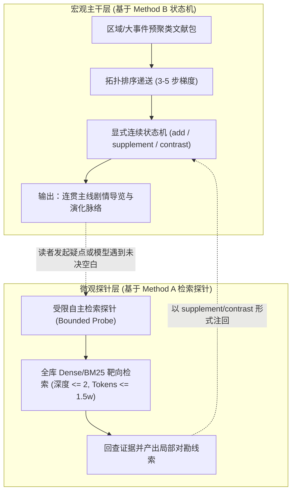

# Phase 05 Navi 架构分析：自主探索与连续理解的机制对比与互补方案

> **历史建议范围（2026-10-20 限定）**：本文记录 2026-10-19 A/B 样本分析，
> 不是已采纳架构或生产合同。后续唯一候选方向为
> [候选 V 研究](p05-navi-v-release-continuity-20261020.md)；
> 本文“两层架构”、预聚类文献包、推导拓扑因果顺序、固定两轮探针和
> 1.5 万 Token 上限均未被采纳。本文建议剔除 `unverified_hypothesis`
> 也不构成授权；工作解释必须继续标记 `unverified_hypothesis_not_fact`。
> 文中的流派立场和效果优劣属于当时研究判断，不能代替来源或语义验收；
> 实际 E1/A 本地检索为 BM25，不应据本文的泛化描述宣称已执行 Dense/Hybrid。
> 历史 `section_only` 降级保留，V 从正式来源动态解析，不继承静态映射作为权威。

> **文档定位与核心目标**  
> 本文结合《原神》官方数据（OBC）的底层结构特征，深入剖析 **Method A（E2 自主搜索阅读）** 与 **Method B（七步给定文档连续理解）** 的内部运行机制。  
> 重点回答：自主探索如何发现关联与产生代价、连续理解如何管理状态与面临何种全库扩展限制，以及两种能力如何在未来的轻量 Navi 架构中实现互补。

---

## 一、底层现实：OBC 数据的本质结构特征

在评估导航算法前，必须首先确立其所面向的物理数据现实。米哈游 OBC 数据库并非结构严整的关系型知识库，亦非单一作者线性写作的编年史，其本质是一个**多源异构、碎片化且高度依附述事立场的游戏世界观知识堆栈**：

1. **载体与流派的多样性 (Heterogeneous Genres)**：
   - **实务调查与公文对话**（如《龙蛇藏归辑录》绘真残影，角色受限于职务视角，带有情绪、偏见与记忆断层）；
   - **上古编年史绝笔**（如《日月前事》，记录创世大事件，但使用神话寓言，且因政治迫害在中途突兀中断）；
   - **民间口头改编与商业演义**（如八重堂版《常世国龙蛇传》，虽存核心母题，但充斥戏剧文学润色，文字亦被转写）；
   - **神明第一人称铭文**（如武器《证誓之明瞳》，极度权威但高度主观，聚焦神明个人死誓动机与契约）；
   - **后世学者批判考据**（如《珊瑚宫民间信仰初勘》，以理性笔调审视神话，辨析“意识之史”与“事实之史”）；
   - **后人百科时间线与角色设定**（如词条《白夜国》与《珊瑚宫心海》，提供概括性定性，但消解了叙事张力）。
2. **信息分布的非对称性 (Dispersed Slices)**：
   - 同一个历史核心（如“奥罗巴斯为何造海祇岛并东征赴死”），被拆散在武器故事、学者小册子、海祇岛任务对话以及鸣神岛神社卷册中。任何单一视角均无法拼出全貌。
3. **Phase 04 的基础设施支撑**：
   - 生产环境通过 535,802 个检索单元 (RU)、双路 Dense/BM25 检索以及延迟足迹装配包 (Evidence Packet)，解决了“如何从海量文本中准确定位相关切片”的物理问题，为上层导航提供了不可篡改的证据底座。

---

## 二、自主探索 A：未知驱动的探针机制与边界困境

### 1. 机制：目标驱动的感知—决策循环 (Probe-and-Sense Loop)
Method A 采用“从未知问题出发，以大模型为决策中枢自主调用 Search / Read 工具”的范式：
- 模型依据当前工作记忆（Memory）提出检索假设；
- 向底层发起 Dense/Hybrid 检索，获得 Top-K 候选 RU；
- 模型自主决定是继续深挖（Read 特定 RU）还是切换方向（Search 新关键词）；
- 循环递进，直至模型认为问题解决或预算耗尽。

### 2. 核心优势：能够发现非预设的跨文档关联
在白夜国实验中，Method A 展现了令人惊叹的自主探案直觉：
- **自主识别版本分叉**：模型在没有任何先验提示的情况下，仅通过检索到八重堂商业版资料页（`3226:s0:u0`），就敏锐联想到此前绘真对话中抱怨归还图书“封面非统一样式、文字看不懂”，自主建立了“鸣神商人再版小说与渊下宫原本分叉”的解释。
- **敏锐捕捉神明自述与民间信仰的反差**：模型在读到《证誓之明瞳》时，立刻抓住了奥罗巴斯“因不胜贵金之神与鸣神才逃亡暗海”的耻辱感，指出其前往海面是为了“履行与天上之都的誓言”，从而对民间广泛流传的“仁爱救民折枝造岛”神话提出了强有力的质疑。

### 3. 固有缺陷与代价分析
这种无先验约束的自主漫游在工程与叙事层面付出了高昂代价：
1. **遗漏关键主干 (Recall Deficiency)**：
   - 由于自主检索的局部吸引子效应（Attractor Effect），模型在发现大蛇与小童的线索后，注意力迅速被蛇神话题吸走，后续检索全部围绕奥罗巴斯展开。
   - 结果导致模型虽然在第 7 轮顺带读取了《日月前事》（`3470:s2:u1`），但未能在 pending clues 中提炼出原初法涅斯创世、第二王座降临海民坠渊等根本世界观设定，造成主干历史的重大遗漏。
2. **局部冲突走偏 (Topic Drift & Fixation)**：
   - 模型在遭遇“绘真看不懂小说文字”与“学者认为牺牲说是推测”两处矛盾时，表现出极强的过度防守性。
   - 它在多轮循环中反复核实相同文档，试图寻找决定性的证据来“证伪”民间传说，在细枝末节上空转。
3. **阶梯式 Token 膨胀 (Quadratic Token Explosion)**：
   - 自主探索要求模型在每一轮决策时，都必须把此前所有轮次执行的工具调用记录、返回的原文切片以及累积的思考记忆完整传入上下文。
   - 17 轮交互直接导致上下文膨胀至 **193,317 Tokens**。模型在第 17 轮因 Token 预算与单轮上下文极限被迫截断，状态终止于 `partial`，未能产生终局收束。

---

## 三、文档连续理解 B：状态机演化机制与全库扩展限制

### 1. 机制：梯度编排与显式演化状态机 (Progressive Continuity State Machine)
Method B 采取“外围提供高质量文献梯度序列，模型在连续上下文中维护显式演化状态”的范式：
- 按照因果/时间层累编排 7 步材料（实务对话 -> 编年史原典 -> 商业小说 -> 神明铭文 -> 学者考据 -> 百科时间线 -> 角色设定）；
- 模型通过显式结构化算子更新知识：
  - `add`：新增确信线索；
  - `supplement`：补充前序线索（如以八重堂出版背景解释绘真图书异样）；
  - `contrast`：建立多重视角对照（如将神明死誓自述与民间救赎神话并列）；
  - `revise` / `supersede`：纠偏或废弃旧认知；
- 每步产出阶段性全局研究摘要（Research Summary），持续压缩并推进主线。

### 2. 核心优势：极高叙事连贯性与卓越算力能效
- **叙事连贯无断裂**：7 步如同一部精心剪辑的学术纪录片，从底层图书管理员的焦虑一步步层层递进，直至原初创世、大蛇誓约、文化遗忘与现代心海的宿命继承，产出 41 条结构严密的线索，因果链完整。
- **包容多元流派的认知理性**：通过 `contrast` 语法，既保留了神话传说的文学温情，又给足了学者专著的理性质疑，彻底避免了 Method A 将所有材料打上 `unverified` 导致的剧情虚无主义。
- **能耗极低**：在 85,389 Tokens 内完成 100% 任务生命周期，能耗仅为 A 的 44%，产出有效线索为 A 的 10 倍。

### 3. 扩展到全提瓦特时的三层物理限制 (Scalability Limits)
若将 Method B 直接推广至整个提瓦特上万篇文献，会立刻撞上以下物理墙：
1. **先验材料选择与排序的预设依赖 (Sequence Ordering Bottleneck)**：
   - 白夜国 7 步的成功，高度依赖于这 7 篇文献的梯次设计（先读绘真引出悬念，再读日书揭开谜底，再读铭文深化动机）。
   - 在提瓦特全量库中，不存在一条全局普适的阅读顺序。如果算法或人类无法为任意两篇材料确定先后因果关系（例如须弥教令院论文与层岩巨渊遗迹志孰先孰后），逆序或乱序输入将导致状态机的 `supplement` 和 `contrast` 算子逻辑紊乱。
2. **长程上下文容量墙 (Context Capacity Wall)**：
   - 白夜国 7 步累积 41 条线索，尚处于大模型单步上下文注意力的黄金窗口（10k~20k active tokens）。
   - 若扩展至 50 步、数百条线索，即使采用摘要压缩，上下文中的活跃线索池也会稀释模型对当前材料的注意力，导致新知识覆盖旧知识或遗忘前序核心事实。
3. **无法应对读者的横向自主跳转**：
   - 固定的阅读梯度无法处理读者突然发起的跳跃式追问（例如读者读到第 3 步突然询问：“那个被关在悬空牢里的安贞最后死了没有？”）。状态机缺乏跳出预设轨道、去全库定位特定人名切片的能力。

---

## 四、两项能力的互补性与极简融合方案

### 1. 两层导航架构：宏观骨干 (B) + 微观探针 (A)
为兼取 Method B 的连贯叙事深度与 Method A 的跨文档穿透直觉，Phase 05 应当采用如下**两层互补架构**：

- **宏观骨干层（Macro Backbone）**：负责全局叙事稳定与历史演化梳理。
  - 对于某个特定区域（如白夜国、鹤观、坎瑞亚遗迹），以主题聚类抽取 5~8 篇核心高密文献，利用拓扑因果关系步进式递送，构建该区域的基石级演化导览。
- **微观探针层（Micro Probe）**：负责跨域查证与疑点穿透。
  - 严格限制自主检索的触发条件：仅当“主线导览中出现明确未决疑点”（如“被盗书籍流落何处”、“安贞结局”）或“读者在交互界面主动发起延伸追问”时触发。
  - 探针运行受严格预算约束（最多 2 轮检索、单次消耗 < 1.5 万 tokens），检索结果作为 `supplement` 片段补充到宏观状态中，随后立即终止。

---

## 五、机制取舍：哪些复用，哪些坚决剔除？

| 机制 / 组件 | 决策 | 采纳理由 / 剔除原因 |
| :--- | :---: | :--- |
| **显式演化原语 (`supplement` / `contrast`)** | **坚决复用** | 完美解决官方材料多视角并存问题，容纳民间传说与学者考据，杜绝虚无主义否定 |
| **三层来源标识与严格降级机制** | **坚决复用** | 生产 RU 哈希 -> 本地组件键 -> `section_only` 保护，确保证据严格可审计，杜绝伪造链接 |
| **阶段性研究摘要 (Research Summary)** | **坚决复用** | 优秀的长期上下文压缩器，使多步推演在有限 Token 下保持因果连贯 |
| **无边界自主漫游循环 (Open E2 Loop)** | **坚决剔除** | 成本呈阶梯式激增（19.3 万 tokens 仍未收束），极易发生关键词偏置与局部空转 |
| **全称防御性怀疑 (`unverified_hypothesis`)**| **坚决剔除** | 把所有官方小说与历史传说一律判定为不可信假说，严重破坏读者的剧情探索获得感 |
| **重型全局知识图谱 (Global Heavy KG)** | **坚决剔除** | 在 Phase 05 现阶段极易导致同义词硬编码与虚假语义对齐，徒增框架复杂度 |

---

## 六、结论与 Phase 05 下一步演进建议

1. **以轻量连续状态机为底座**：本轮实验充分证明，在处理原神这类富文本、多流派的游戏剧情时，结构化的连续状态机（Method B）无论在效果、可解释性还是算力成本上均大幅优于开放自主检索（Method A）。
2. **探针作为靶向插件**：将自主检索能力降维包装为“单点查证探针”，只在特定疑难上发力，从而彻底根治其成本失控与主题跑偏的弊端。
3. **技术纪律坚持**：继续维持“零全库构建、零外部向量库、零重型 KG、零付费调用”的审慎纪律，依靠确定性工程机制与严谨的来源回查，稳步推进 Phase 05 语义导航。
