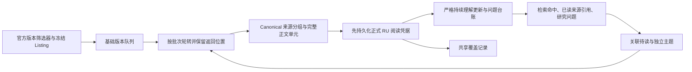

# Phase05 Navi 候选 V：版本队列与持续理解离线研究（2026-10-20）

本轮实现并验证一个 opt-in 研究原型。结论是：版本进度、动态资料和独立主题可以共用一份持续理解历史，阅读覆盖可以独立、可恢复地核算。离线回放证明这些机制可运行，尚不能证明模型自主选材质量、真实修订质量或长期语义收敛。没有调用付费模型，也没有启用生产。

## 架构取舍



- **排队依据**：直接读取已冻结官方筛选器的版本次序，同版本按原 Listing 位置。它是稳定阅读顺序，不是剧情时间线、任务前置关系或已经核实的发布日期。缺失、冲突、未知版本进入待核实清单。研究只选明示的小范围基础队列，其余目录项仍未读。
- **任务内部边界**：校验 Canonical `layout_observations` 与 `source_template_layout` 后恢复来源分组和模块位置。当前任务阅读策略选择 `interactive_dialogue` 及名为“剧情对话”的 `collapse_panel`，完整交付 rich-text occurrence；其他载体及未知结构记 disposition/issue。该策略没有声称覆盖所有任务模板。互动对话按来源根与边组织展示，选项、分支、异常、不可达节点同时保留；遍历次序不声明唯一剧情路径。
- **覆盖账与研究账分开**：覆盖键包含绑定快照、Canonical record、section、unit；一个 occurrence 的全部正式 RU 分片必须完整匹配正文。结构化载体、图副本不重复计数。遇到页面时先登记该页所有可读分组；命中分组之外的正文继续列为未读，目录登记不算正文交付。同一来源可归属多个主题；默认复用覆盖记录，显式回查需要理由并另记字符费用。不同快照/来源 occurrence 不合并。分组为未读、部分或范围内正文完整；后者不表示整页内容或语义已完全理解。
- **调度与持续理解**：版本、关联、独立主题三个非空队列按阅读批次轮转。跨版本阅读允许；非任务资料可以直接作为独立种子，也可以在关联阅读后转为独立主题。所有主题共用 `ContextContinuityState` 与 `ClueEvent` 历史，保留新增、补充、对照、修订和替代。来源流派可明确为 `unclassified`，无需强制归类。
- **交付先于理解**：持久化不可覆盖、带校验链的阅读检查点后，才应用理解更新。失败保留“已交付、待理解”；恢复绑定原输入与检查点，不自动重读。无效操作、未知目标、未交付或无法解析的正式引用被原子拒绝，不改成新增。摘要和搜索片段不算已读。
- **引用边界**：全部工作解释标记 `unverified_hypothesis_not_fact`，来源绑定与语义验收分开。V 不产生 Generation 输入或正式引用；最终引用仍需原有 Evidence Packet。Canonical、RU、Generation 接口没有改变。

三队列轮转、整单元不拆分、上下文只带最近未处理批次及有限线索都是研究运行点，不冻结为生产架构。超长单元暂留待研究，未建立任意截断后的“完整已读”状态。

## 数据核查

可重复的目录核查读取 Raw Listing，并逐页验证 Parsed/Canonical 记录 SHA 与标签关联；不执行全库语义研究。结果保存在运行根的 `catalog.json`、`catalog_audit.json`。

| 项目 | 本轮确认 |
| --- | --- |
| 任务频道页面 | 1,051；其中 1,042 带单一已知版本、9 缺版本 |
| 标签位置 | Canonical `record_metadata.source_metadata.ext.fe_ext`；全部与 Listing/Parsed 一致 |
| 版本顺序 | 官方筛选器明确 `5.8 → 月之一…月之八 → 7.0`；不制造数字映射 |
| 版本家族页数 | 1.x 133、2.x 119、3.x 158、4.x 220、5.x 145、月之系列 244、7.0 23，总计 1,042 |
| 任务类型 | 世界 715、限时 316、魔神 50、传说 126、其他 3；162 页多标签，3 页缺类型，不能当互斥分组相加 |
| 页面与分组 | `3429` 一页/一组/8 section；`6236` 一页/四组/28 section；均不等同游戏任务数量 |

Antigravity 调查的版本分组合计有算术错误，Canonical 顶层 `metadata` 查找也漏掉了实际嵌套字段。上述核查修正这两项。非任务材料也可能带版本标签或结构引用；书籍/武器抽查不能推广为“所有非任务材料无版本、只能语义连接”。V 不因材料不在任务版本目录中而拒绝独立研究。

`3429:s7:u2` 的正式 RU 为 `2d7318f2ed3ec55884b274dee5d8d3b04b77b2c200a0b7ea31f86b4833494881`。旧 B 静态来源索引遗漏该 RU；本轮由正式加载器和 Canonical projection 动态解析。旧 `section_only` 记录和历史 run 保持不变。历史坐标只作为待核实定位提案，绝不作为正式 RU ID。

## 实现与复现

- `retrieval/navi_reading.py`：目录构建、模板分组、来源拓扑、完整正文到正式 RU 的动态映射；复用 E1 清单验证和正式 RU 加载器。
- `rag/navi_v_experiment.py`：`ReadingSession.create/resume`、`search/enqueue/read_next/understand`、`apply_decision/run` 和 `coverage_summary`。决策函数可注入；未实现新模型传输。
- `rag/navi_v_research.py`：真实数据离线入口，保存目录审计、代码指纹、A/B 运行树哈希、来源凭据、拒绝记录和结果。
- `tests/retrieval/test_navi_v.py`：使用现有小型 checked-in Canonical fixture 构建临时正式 RU/索引，无需全库或网络。

在仓库根目录用 PowerShell 7 执行，输出目录必须不存在：

```powershell
$env:PYTHONPATH = 'src'
python -m genshin_corpus.rag.navi_v_research --output data/retrieval/p05-navi-v-offline-local-r1
python -m unittest tests.retrieval.test_navi_v tests.retrieval.test_navi_exploration tests.retrieval.test_byakuyakoku_continuity tests.retrieval.test_byakuyakoku_continuity_experiment tests.retrieval.test_p05_semantic_navigation tests.retrieval.test_navi_e2_experiment tests.retrieval.test_navi_e2_responses tests.retrieval.test_navi_e2_research_recovery -q
```

入口支持 `--canonical-manifest`、`--ru-manifest`、`--lexical-manifest`、`--listing`、`--historical-a`、`--historical-b` 覆盖本地样本路径。通用检查点恢复接口为 `ReadingSession.resume(sources, catalog, root)`；恢复不会自动调用模型或重新交付已完成批次。

每案例默认研究上限：32 个动作、4 次搜索、8 个实际交付页面、30,000 新增正文字符、每批 8,000 正文字符；另设 300,000 工具响应字符和 6,000 摘要字符上限。显式回查单独核算，受动作、批次和响应上限约束。上限耗尽时保留队列、未读 occurrence、候选、问题及异常清单。

## 真实材料证据

最终运行根为 `data/retrieval/p05-navi-v-offline-20261020-r3/`。`r1`、`r2` 保留为中间试验；`r3` 补齐同页未读分组目录，不覆盖早期结果。

白夜国基线从 `3429` 开始，下一项 `3428` 由冻结目录自然选出。后续材料不使用旧七篇列表：只回放旧 A 中确实出现在已交付书名里的查询，再从当前实际 BM25 命中选取来源。旧 B 更新以历史定位提案解析到本次实际交付的正式 RU；缺来源或缺目标的更新保持 pending。此处验证记录回放与严格状态演进，不声称新 AI 已自主完成 V，也不声称历史定位提案已通过语义复核。

首轮 `r1` 在 20 个动作、3 次搜索中交付 5 页/5,239 新增正文字符；按 `u2 → u3 → u1` 交付种子，将同一本书的 3 个 occurrence（787 字）复用于独立主题，正文重复交付为零，并返回 `3428` 基础进度。它也暴露首条 BM25 命中偏移：《日月前事》选到了“狄奥提玛”资料分组，仅有 26 字的资料字段，未读到目标书正文。`r2` 加入“所选标题及正文无书名字面命中时回放已记录细化查询”的试验条件，但 NPC 简介恰好写着“把日月前事当睡前读物”，没有触发细化搜索。实际仍只执行 3 次搜索；字面命中检查不足以识别正文缺口。`r3` 没有把这条失败策略提升为生产规则，重点补齐同页未读范围的核算。

最终 `r3` 的核算如下；所有“已读”均指机械正文交付，不是语义验收：

| 项目 | 白夜国 | 卡利贝尔 |
| --- | --- | --- |
| 动作 / 搜索 | 20 / 3 | 10 / 0 |
| 已遇到页面 / 实际新增正文 | 5 页 / 5,239 字 | 1 页 / 17,128 字 |
| 正文目录 / 已交付 / 未读 occurrence | 33 / 16 / 17 | 4 / 4 / 0 |
| 来源正文分组状态 | 5 组范围内完整，5 组未读；两页仍有未读组 | 4 组范围内完整 |
| 跨主题正文复用 / 重复交付 | 3 个 occurrence / 0 字 | 0 / 0 字 |
| 磁盘恢复 | 完整状态一致 | 拒绝后恢复一致，原批次不重读 |
| 理解更新 | 10 add、2 supplement、1 contrast，均为旧 B 回放 | 空更新，明确尚无剧情解释 |

白夜国另保留 28 条未能回放的旧 B 更新、11 个尚未交付的命中 RU、6 条语义复核待办记录和 9 页版本缺口。命中 RU 可能包含结构载体副本，不能直接当成 11 段新剧情；6 条待办也不代表 6 个独立语义问题。`3470:s2:u1` 的 1,841 字《日月前事》正文明确列为未读。未读清单和每个正式来源地址见 `byakuyakoku/result.json` 的 `coverage.unread_occurrences`；不会因该页另一组已读而把整页完成。

主证据为 [result.json](../../../data/retrieval/p05-navi-v-offline-20261020-r3/result.json)、[目录审计](../../../data/retrieval/p05-navi-v-offline-20261020-r3/catalog_audit.json)、[导航与连续理解测试输出](../../../data/retrieval/p05-navi-v-offline-20261020-r3/targeted-tests.txt) 和 [Evidence/Generation 边界测试输出](../../../data/retrieval/p05-navi-v-offline-20261020-r3/evidence-boundary-tests.txt)。正式来源工具身份为 `dfa23fcb263d3adeb6d1f0ef6d6e9b5896a210c69d6eaf9844df9d87655a694b`；历史 A/B 树哈希为 `eddf4a617d11e3eac4151900ba16498e7b3f3d3121c786d52e1af33f1310732d`，运行前后一致。运行保存的四个实现文件指纹与最终源码一致。

《卡利贝尔》按来源分组 `771 → 845 → 844 → 843` 分四批交付 5,535 / 5,106 / 2,729 / 3,758 字，共 17,128 字。首批交付后注入一次未读 RU 引用，被严格拒绝；从磁盘恢复后处理原凭据，再继续剩余三组，没有重复交付。理解动作明确记录“尚未生成剧情解释”，不伪造第二种案例的模型结论。

运行证据分别记录：实际选择与来源出处、正文覆盖及排除范围、跨主题复用、未理解/待追查事项、元数据缺口、状态恢复一致性，以及历史 A/B 所有文件的运行前后哈希比较。

针对性验证已通过：27 项 V fixture 测试；连同 E1/E2、连续理解与导航共 245 项，另有 88 项 Phase04 检索/装配及 Generation 边界测试，共 333 项。V 测试覆盖版本排序、多标签计数、模板不一致、分支/环/不可达节点、整单元分片映射、部分读取/超长递延、同页未读分组及未读正式 RU 拒绝、回查、无任务基线的独立非任务种子、跨主题复用、严格引用、原子拒绝、修订替代链和检查点恢复。

## 相对于旧 A/B 的变化与限制

| 关注点 | V 的机制证据 | 仍未解决 |
| --- | --- | --- |
| 人工预选材料 | 基线由版本目录选取；支持资料从真实命中选择，未使用七篇 allowlist | 查询及首命中选择仍是历史回放策略，尚无新模型自主选材证据 |
| 自主探索走偏 | 三队列轮转能返回版本进度；不匹配材料与剩余问题留账 | 轮转不保证相关性；首条 BM25 命中已经暴露偏移，资料类型/正文边界仍需更广样本验证 |
| 重复阅读 | 跨主题共享一次覆盖；显式回查必须说明目的；理解失败可恢复而不重读 | 尚未验证长期摘要丢失后何时应当回查，以及大线索集如何按问题取回 |
| 覆盖遗漏 | 未入选目录项、未读命中、超长单元、排除载体、待理解和元数据缺口可枚举 | 范围内正文完整不等于整页/全语料/剧情覆盖；未计算全库召回率 |
| 持续理解 | 新增、补充、对照进入同一历史；严格引用和目标检查 | 历史 B 只有 add/supplement/contrast；真实 revise/supersede 的质量仍未知 |

旧 A 对照运行有 33 次 read、16 个不同 RU、19 次 search、28 个 partial 凭据。partial 可能只表示元数据/Canonical payload 未完整交付，不能把全部重复 read 判成浪费。旧 B 有 22 add、14 supplement、5 contrast；其七页人工编排与 V 有不同阅读范围，不能据成本或线索条数直接比较优劣。旧 GPT-6-Luna r2 是 7 次读取/5 页，而不是 Antigravity 文中泛称的 16 个 RU。

本轮没有做正式 Packet/答案 A/B 实验，没有改变 Phase04 生产路径。正式 RU 校验和现有 BM25 会扫描完整本地产物来验证完整性/计算词法统计，但只保留、交付限定页面；这不等于全库语义运行。重复扫描的耗时也表明当前原型不适合作为长时生产调度器。

## 待验证问题

1. 在新模型决策下能否减少人工编排，同时避免 metadata/攻略/同名材料吸走注意力；更广任务模板是否需要新的显式正文策略。
2. 长正文超过单批时，保留完整单元的递延策略是否过于保守；怎样在不损失来源结构和引用边界下补读。
3. 多主题长期积累后如何检索旧线索、归并并关闭待追查问题和选择回查；当前有限摘要与线索窗口不能保证长期语义一致；完整未读目录可由 `coverage_summary()` 取得，但尚未为模型提供专门的分页浏览/回查工具。
4. 真正冲突材料下 revise/supersede 是否合理，旧解释怎样被可靠追溯；确定性生命周期测试不能替代语义验证。
5. 快照更新后的差异研究与迁移尚未实现；当前恢复要求相同绑定输入，不跨快照合并覆盖。

这些问题尚不阻断本轮离线机制交付。没有影响正式来源身份的未决架构冲突。本轮不申请或执行付费测试；若下一工作单元确需新模型语义验证，应先提交具体模型与路线、调用数、费用上限和停止条件，经费用批准后执行。
